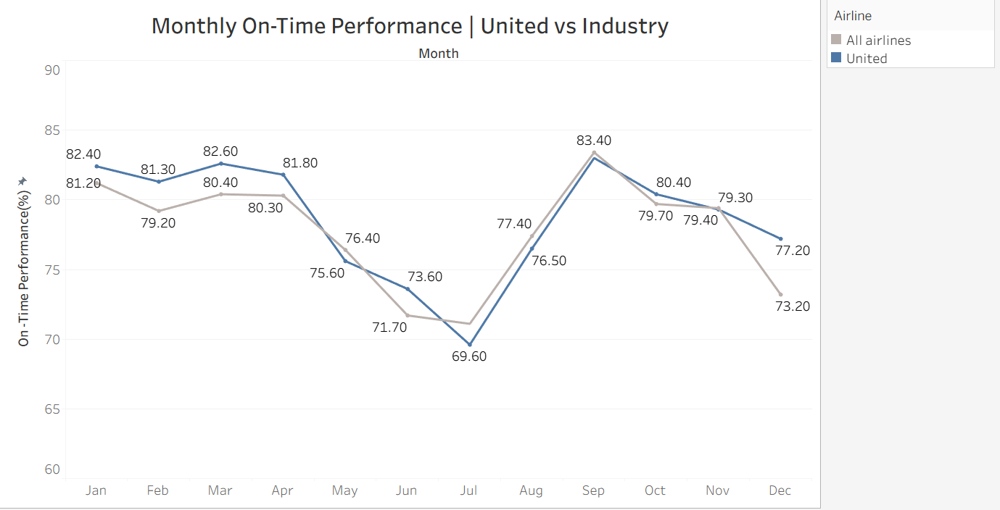
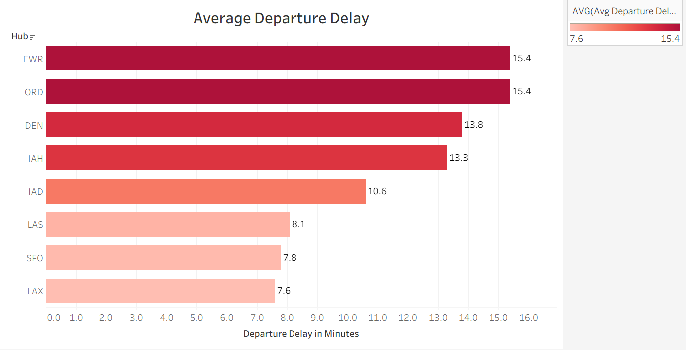
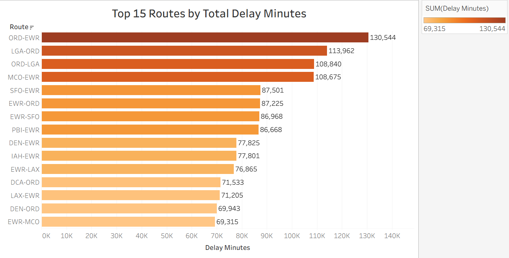
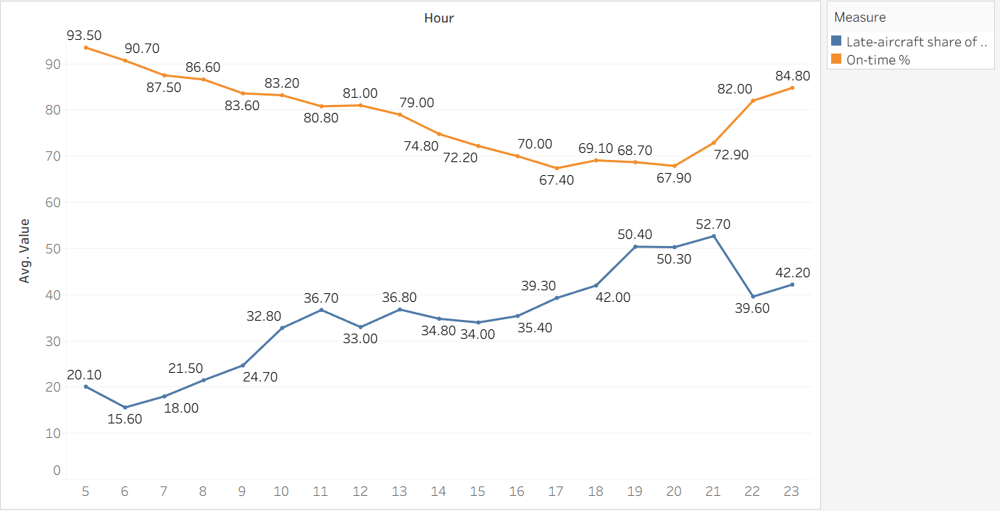
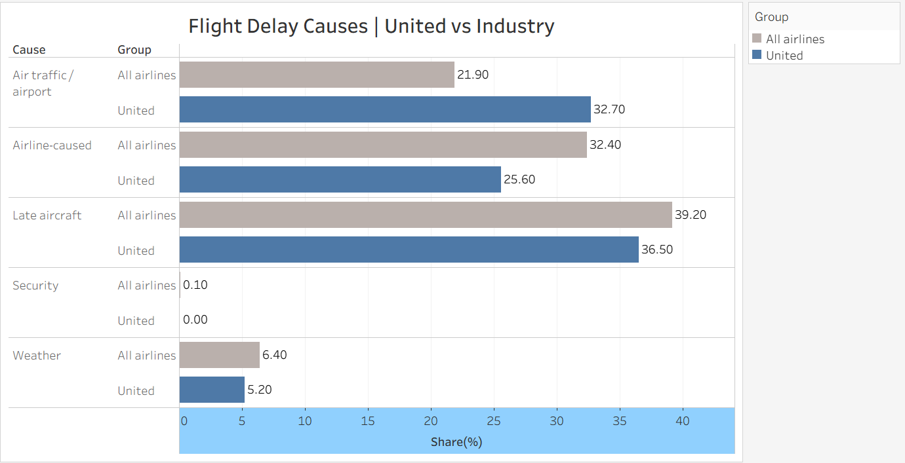
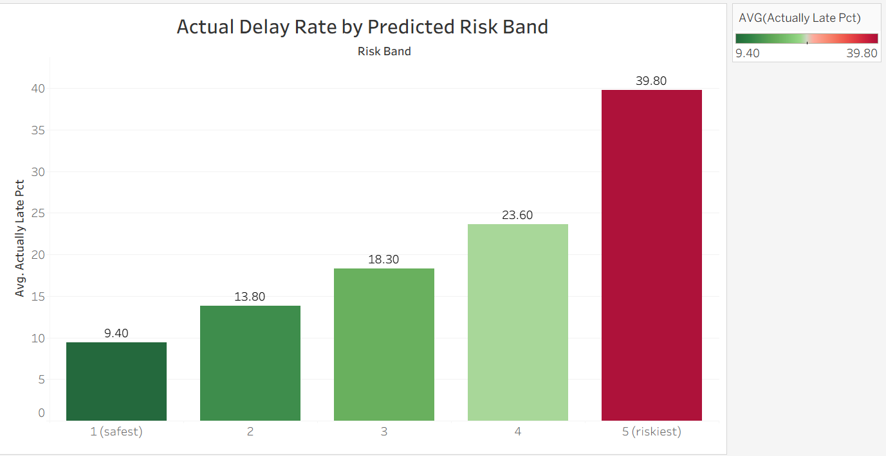
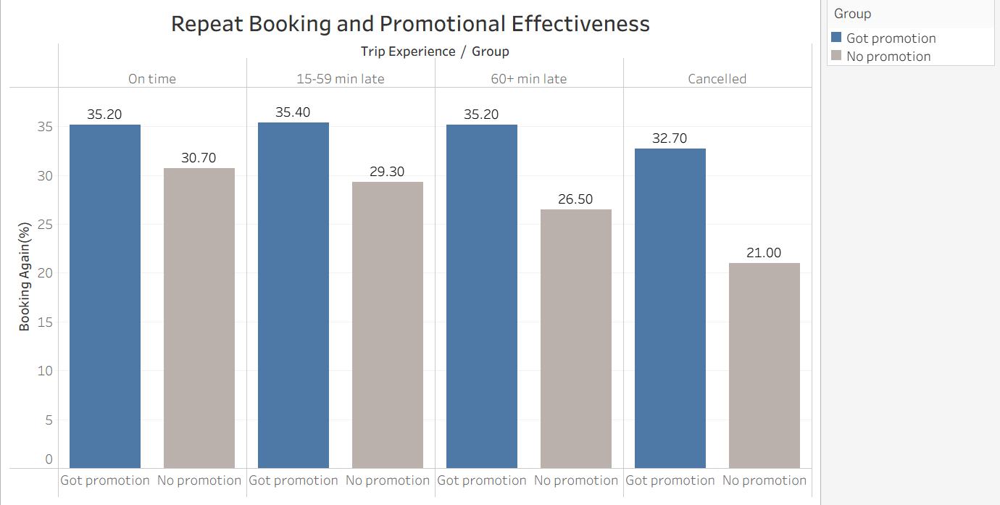
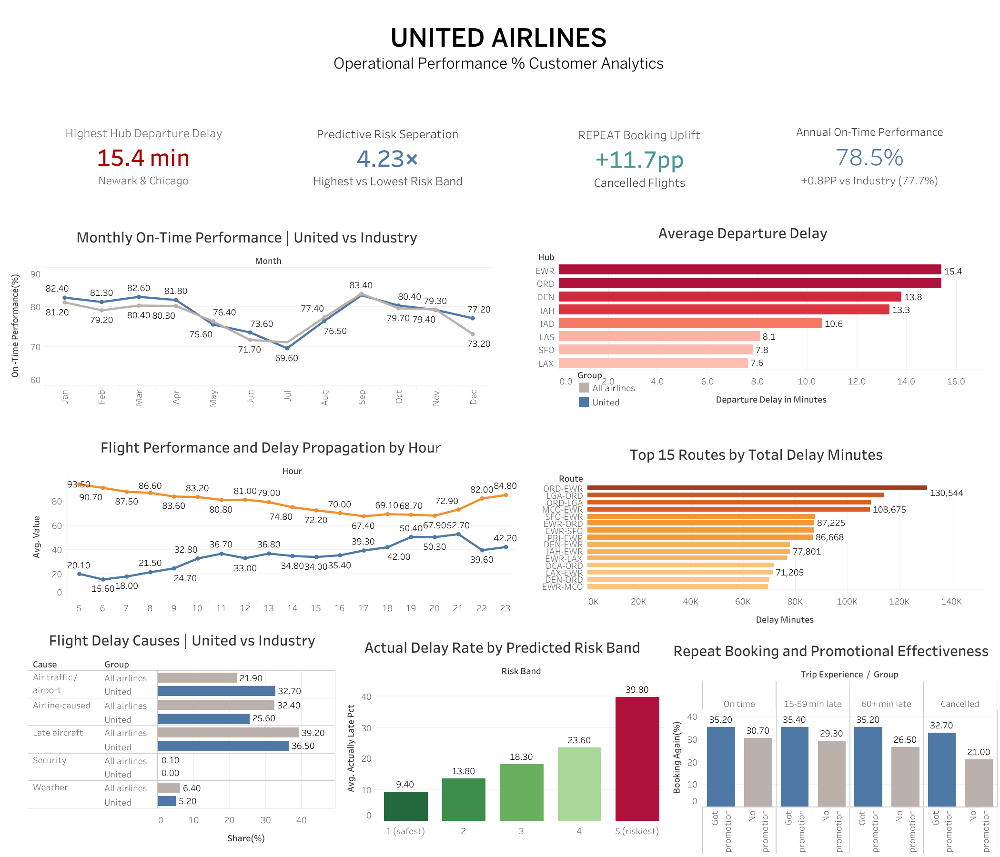

# ✈️ United Airlines — Operations & Customer Retention Analytics

### End-to-End Data Analytics | Business Intelligence | Predictive Modelling


---

## 📌 Project Overview

This end-to-end data analytics project investigates United Airlines' operational performance, flight delay patterns, predictive delay risk, customer retention and promotional effectiveness using more than 7 million US domestic flight records.

The project integrates SQL-based data preparation, Python exploratory data analysis, machine learning, statistical hypothesis testing, Excel business reporting and an interactive Tableau executive dashboard to transform raw operational data into actionable business insights.

The primary objective is to demonstrate how data-driven decision-making can help airlines improve operational efficiency, identify high-risk flights, prioritize operational resources and develop effective customer retention strategies.

> **Disclaimer:** This is an independent analytics portfolio project and is not affiliated with United Airlines. Flight operations data is sourced from publicly available government records. Customer loyalty behaviour and promotional outcomes are simulated for analytical demonstration.

---

## 📊 Executive Summary

| Key Performance Indicator | Result |
|---|---:|
| Total flight records analyzed | 7,001,619 |
| Airlines benchmarked | 14 |
| United Airlines flight records | 795,271 |
| United on-time performance | 78.5% |
| Industry on-time performance | 77.7% |
| Worst-performing month | July — 69.6% |
| Highest average hub departure delay | EWR and ORD — 15.4 min |
| Highest-to-lowest predictive risk ratio | 4.23x |
| Simulated loyalty members | 50,000 |
| Maximum simulated promotional uplift | +11.7 percentage points |

### Key Business Findings

- United Airlines outperformed the overall industry benchmark by approximately 0.8 percentage points in on-time performance.
- July emerged as the weakest month for operational punctuality.
- Newark and Chicago O'Hare emerged as priority airports for operational investigation.
- Late-arriving aircraft represented the largest share of United's delay minutes.
- On-time performance deteriorated throughout the operating day, consistent with delay propagation.
- Predictive modelling successfully differentiated higher-risk and lower-risk flights.
- Simulated promotional offers demonstrated the greatest repeat booking uplift among customers experiencing cancellations.

---

## 🎯 Business Objectives

The project addresses eight primary business questions:

1. How does United Airlines perform compared with the overall airline industry?
2. Which months and departure hours experience the highest operational delays?
3. Which airports and flight routes contribute the greatest cumulative delay burden?
4. What are the major underlying causes of flight delays?
5. Can machine learning identify flights with elevated delay risk?
6. How might negative flight experiences affect customer retention?
7. Can targeted promotional offers improve repeat booking behaviour?
8. How can analytical findings be translated into actionable business strategies?

---

## 🛠️ Tools and Technologies

| Technology | Application |
|---|---|
| SQL Server | Data ingestion, cleaning, transformation and business analysis |
| Python | Exploratory data analysis, statistical analysis and predictive modelling |
| Pandas | Data manipulation, cleaning and aggregation |
| NumPy | Numerical computation |
| Matplotlib | Exploratory data visualization |
| Scikit-learn | Machine learning and model evaluation |
| SciPy | Statistical hypothesis testing |
| Statsmodels | Statistical modelling and confidence intervals |
| Tableau | Interactive dashboards and business intelligence |
| Microsoft Excel | KPI reporting and what-if analysis |
| Microsoft PowerPoint | Executive presentation and business storytelling |

---

## 📁 Dataset

### 1. Flight Operations Data

**Source:** [US Bureau of Transportation Statistics — BTS](https://www.transtats.bts.gov/)

| Attribute | Description |
|---|---|
| Dataset | Reporting Carrier On-Time Performance |
| Period | January–December 2025 |
| Total records | 7,001,619 |
| Reporting airlines | 14 |
| Primary airline | United Airlines (UA) |
| Data type | Real-world operational data |

### Major Dataset Attributes

- Flight date
- Reporting airline
- Origin and destination airports
- Scheduled departure time
- Actual departure time
- Scheduled arrival time
- Actual arrival time
- Arrival and departure delays
- Flight distance
- Cancellation indicators
- Diversion indicators
- Carrier delay
- Weather delay
- National Airspace System delay
- Security delay
- Late-aircraft delay

United Airlines analysis focuses on mainline flights reported under the UA carrier code.

A completed flight is classified as late when its arrival delay is at least 15 minutes.

### 2. Simulated Customer Loyalty Data

A separate synthetic dataset containing 50,000 fictional loyalty members was generated and linked to real United Airlines flight experiences.

The dataset includes simulated:

- Customer characteristics
- Flight experiences
- Loyalty behaviour
- Promotional assignments
- Repeat booking outcomes

The synthetic dataset enables the demonstration of customer segmentation, retention analytics, A/B testing and statistical inference without accessing confidential airline customer records.

Customer behaviour is simulated and does not represent actual United Airlines customers.

---

## 🔄 End-to-End Analytical Workflow

```mermaid
flowchart TD
    A[Raw BTS Flight Data] --> B[SQL Server Data Ingestion]
    B --> C[Data Cleaning and Transformation]
    C --> D[SQL Business Analysis]
    D --> E[Python Exploratory Data Analysis]
    E --> F[Operational Performance Analysis]
    E --> G[Predictive Machine Learning]
    E --> H[Simulated Customer Analytics]
    G --> I[Model Evaluation and Risk Segmentation]
    H --> J[Python Statistical Analysis and A/B Testing]
    F --> K[Tableau Executive Dashboard]
    I --> K
    J --> K
    F --> L[Excel Business Reporting]
    J --> L
    K --> M[Business Recommendations]
    L --> M
    M --> N[Executive Presentation]
```



---

## 1. SQL Data Preparation and Business Analysis

SQL Server was used to process and analyze more than 7 million flight records.

### Data Preparation

- Imported monthly flight datasets into staging tables.
- Converted columns into appropriate data types.
- Handled missing values and incomplete records.
- Created analytical views for operational reporting.
- Separated completed, cancelled and diverted flights.
- Standardized operational performance metrics.
- Prepared aggregated datasets for Python and Tableau.

### SQL Concepts Applied

- SELECT and WHERE
- GROUP BY and HAVING
- Aggregate functions
- CASE statements
- Joins
- Common Table Expressions (CTEs)
- Analytical views
- Conditional aggregation
- Date and time functions
- KPI calculations

### Business Metrics Calculated

- Total flight volume
- On-time performance
- Average departure delay
- Cancellation rates
- Monthly performance
- Airport performance
- Route-level delay burden
- Delay cause distribution
- Customer repeat booking rates
- Promotional uplift

SQL served as the foundational analytical layer for transforming raw operational records into structured business intelligence datasets.

---

## 2. Exploratory Data Analysis

Python was used to investigate operational patterns, identify performance bottlenecks and generate actionable business insights.

### 2.1 Airline Industry Benchmarking

United Airlines' operational performance was compared with the overall airline industry.

| Metric | On-Time Performance |
|---|---:|
| United Airlines | 78.5% |
| Overall industry | 77.7% |
| Performance difference | +0.8 pp |

United Airlines performed slightly above the industry benchmark, although substantial variation existed across months, airports and departure hours.

### 2.2 Monthly Performance Analysis



United Airlines experienced significant seasonal variation in on-time performance.

#### Key Findings

- July recorded the lowest on-time performance at 69.6%.
- September recorded approximately 83% on-time performance.
- Both United Airlines and the overall industry experienced weaker summer performance.
- United performed better than the industry benchmark during December.

#### Business Implication

Airlines should investigate additional operational preparedness, staffing, aircraft availability and schedule resilience ahead of peak summer travel demand.

---

### 2.3 Airport and Hub Performance Analysis



| Airport | Average Departure Delay |
|---|---:|
| Newark Liberty (EWR) | 15.4 min |
| Chicago O'Hare (ORD) | 15.4 min |
| Denver (DEN) | 13.8 min |
| Houston (IAH) | 13.3 min |
| Washington Dulles (IAD) | 10.6 min |

Newark and Chicago emerged as priority airports for further operational investigation.

Airport performance was evaluated using departure delay metrics and operational flight volumes.

#### Business Implication

Operational improvement initiatives should investigate airport congestion, turnaround efficiency, scheduling constraints and resource allocation at high-delay airports.

---

### 2.4 Route Performance Analysis



Flight routes were ranked according to cumulative delay minutes to identify corridors contributing the greatest operational delay burden.

| Route | Total Delay Minutes |
|---|---:|
| ORD–EWR | 130,544 |
| LGA–ORD | 113,962 |
| ORD–LGA | 108,840 |
| MCO–EWR | 108,675 |

The route-level findings reinforced the importance of Newark and Chicago within United Airlines' operational network.

#### Analytical Consideration

Total delay minutes measure the cumulative operational burden but are influenced by flight volume.

Therefore, high cumulative delay does not necessarily indicate the worst average flight-level performance.

#### Business Implication

Prioritize high-impact corridors when investigating operational bottlenecks and evaluate delay minutes per flight alongside total delay minutes.

---

### 2.5 Hourly Performance and Delay Propagation



On-time performance generally deteriorated throughout the operating day, while the contribution of late-arriving aircraft increased.

#### Key Findings

- Early morning flights demonstrated stronger punctuality.
- On-time performance reached 93.5% at 05:00.
- Punctuality declined substantially during the afternoon and evening.
- Late-aircraft delays accounted for 52.7% of delay minutes at 21:00.

These patterns are consistent with delay propagation, where disruptions affecting earlier flights can influence subsequent aircraft operations.

Aggregate hourly trends alone do not establish individual aircraft-level causality.

#### Business Implication

Investigate aircraft turnaround buffers, aircraft rotation schedules and proactive operational interventions to reduce cascading delays.

---

### 2.6 Root Cause Analysis



| Delay Cause | United Airlines | Industry |
|---|---:|---:|
| Late Aircraft | 36.5% | 39.2% |
| Air Traffic / Airport System | 32.7% | 21.9% |
| Airline-Caused | 25.6% | 32.4% |
| Weather | 5.2% | 6.4% |
| Security | 0.0% | 0.1% |

#### Key Findings

- Late-arriving aircraft represented the largest share of United's delay minutes.
- Air traffic and airport-system delays represented 32.7% of United's delay minutes.
- United's air traffic and airport-system delay share was approximately 10.8 percentage points higher than the industry benchmark.
- United recorded a lower airline-caused delay share than the overall industry.

These percentages represent the composition of delay minutes rather than the probability of a flight being delayed.

#### Business Implication

Operational improvements should consider both internal airline processes and external airport-system constraints.

---

## 3. Predictive Machine Learning



### Objective

Develop a predictive approach capable of distinguishing flights with higher and lower arrival delay risk.

Rather than relying solely on historical averages, predictive modelling provides a framework for proactive operational decision-making.

### Target Variable

Binary classification:

- **0:** Flight arrives on time.
- **1:** Flight arrives at least 15 minutes late.

### 3.1 Planning Model

The planning model uses information available before flight operations.

#### Input Features

- Month
- Day of week
- Scheduled departure hour
- Origin airport
- Destination airport
- Flight distance

#### Algorithms

- Logistic Regression
- Gradient Boosting Classifier

### 3.2 Day-of Operational Model

A separate day-of model investigates additional operational signals from earlier flights.

The purpose is to assess whether more recent operational information can support improved flight risk prioritization.

### 3.3 Training and Testing Strategy

A chronological train-test split was used to preserve the temporal nature of flight operations.

| Dataset | Period | Records |
|---|---|---:|
| Training | January–September | 584,187 |
| Testing | October–December | 202,190 |

A chronological split is more representative of real-world forecasting than randomly mixing historical and future flight records.

### 3.4 Planning Model Evaluation

| Model | ROC-AUC | Accuracy | Precision | Recall |
|---|---:|---:|---:|---:|
| Logistic Regression | 0.632 | 67.6% | 30.6% | 43.1% |
| Gradient Boosting | 0.647 | 75.8% | 36.5% | 20.8% |

The reported classification metrics use a probability threshold of 0.30.

### Evaluation Metrics

- Accuracy
- Precision
- Recall
- ROC-AUC
- Permutation feature importance
- Risk-band analysis

### Interpretation

An always-on-time baseline achieves approximately 79% accuracy because delayed flights represent approximately 21% of the test dataset.

Consequently, accuracy alone is insufficient to determine model usefulness.

ROC-AUC, precision, recall and risk separation provide additional insight into the model's ability to identify higher-risk flights.

Gradient Boosting achieved a higher ROC-AUC than Logistic Regression, although overall discrimination remained modest.

### 3.5 Feature Importance

Permutation feature importance was used to investigate which input variables contributed most strongly to planning-model performance.

Scheduled departure hour emerged as the most important feature in the planning Gradient Boosting model.

This finding is consistent with the observed deterioration in flight punctuality throughout the operating day.

Feature importance indicates predictive contribution and should not be interpreted as proof of causation.

### 3.6 Day-of Model Risk-Band Analysis

Flights were segmented into five predicted risk bands.

| Predicted Risk Band | Actual Late Flight Rate |
|---|---:|
| Band 1 — Lowest Risk | 9.4% |
| Band 2 | 13.8% |
| Band 3 | 18.3% |
| Band 4 | 23.6% |
| Band 5 — Highest Risk | 39.8% |

**Risk Separation:**

Highest-risk delay rate / Lowest-risk delay rate

39.8 / 9.4 = **4.23x**

Flights in the highest-risk band experienced delays at approximately 4.23 times the rate of flights in the lowest-risk band.

The increasing observed delay rate across risk bands demonstrates the model's ability to rank flight delay risk.

### Business Applications

- Prioritize high-risk flights for operational monitoring.
- Support proactive resource allocation.
- Identify flights requiring additional operational attention.
- Investigate potential disruptions before departure.
- Support risk-based operational decision-making.

The model is intended for risk prioritization rather than guaranteed flight-level forecasting.

Planning-model evaluation metrics and day-of risk-band results represent separate modelling approaches.

---

## 4. Customer Loyalty and Retention Analytics



### Business Problem

Flight delays and cancellations can negatively affect customer satisfaction, brand loyalty and future booking behaviour.

This component explores how airlines could evaluate targeted promotional offers following disrupted journeys.

### Methodology

- Generated 50,000 simulated loyalty members.
- Linked fictional customers to real United Airlines flight experiences.
- Simulated customer characteristics and repeat booking behaviour.
- Randomly assigned promotional offers to approximately half of the simulated members.
- Segmented customers according to flight experience.
- Compared repeat booking rates across promotional groups.
- Evaluated promotional effectiveness using statistical methods.

### Customer Segmentation

Customers were segmented according to four trip experiences:

1. On-time flights
2. Moderate delays of 15–59 minutes
3. Severe delays of 60 minutes or more
4. Cancelled flights

### Repeat Booking Analysis

| Trip Experience | No Promotion | Received Promotion | Absolute Uplift |
|---|---:|---:|---:|
| On Time | 30.7% | 35.2% | +4.5 pp |
| Delay: 15–59 Minutes | 29.3% | 35.4% | +6.1 pp |
| Delay: 60+ Minutes | 26.5% | 35.2% | +8.7 pp |
| Cancelled | 21.0% | 32.7% | +11.7 pp |

### Key Findings

- Repeat booking rates declined as the severity of flight disruption increased.
- Promotional groups demonstrated higher simulated repeat booking rates.
- Customers experiencing cancellations demonstrated the largest absolute promotional uplift.
- Targeted promotional strategies may be worth investigating for customers experiencing significant disruptions.

### Business Implication

Instead of distributing identical promotional offers to all customers, airlines could investigate differentiated service recovery strategies based on the severity of flight disruption.

These findings are generated from simulation assumptions and must not be interpreted as actual United Airlines customer behaviour or verified promotional effectiveness.

---

## 5. Statistical Analysis and A/B Testing Using Python

### Objective

Evaluate differences in simulated repeat booking behaviour using statistical inference and demonstrate how promotional campaigns can be assessed through controlled experiments.

The statistical analysis was implemented entirely in Python.

### Libraries Used

- Pandas
- NumPy
- SciPy
- Statsmodels

### 5.1 A/B Testing Framework

| Component | Description |
|---|---|
| Control Group | Customers who did not receive a promotional offer |
| Treatment Group | Customers who received a promotional offer |
| Outcome Variable | Repeat booking within 90 days |
| Experiment Type | Simulated randomized controlled experiment |
| Significance Level | 0.05 |
| Confidence Level | 95% |

### 5.2 Hypothesis Formulation

**Null Hypothesis (H0):**

There is no difference in repeat booking rates between the promotional and non-promotional groups.

**Alternative Hypothesis (H1):**

There is a difference in repeat booking rates between the promotional and non-promotional groups.

### 5.3 Statistical Techniques

#### Two-Proportion Comparisons

Used to compare repeat booking proportions between treatment and control groups.

#### Chi-Square Test

Used to investigate associations between categorical variables such as promotional assignment and repeat booking outcomes.

#### P-Value Interpretation

Used to evaluate the strength of evidence against the null hypothesis.

#### 95% Confidence Intervals

Used to quantify uncertainty around estimated differences in repeat booking rates.

#### Logistic Regression

Used to investigate relationships between customer characteristics, flight experience, promotional assignment and repeat booking probability.

#### Odds Ratio Analysis

Used to interpret the relationship between explanatory variables and the odds of repeat booking.

#### Interaction Analysis

Used to investigate whether the association between promotional offers and repeat booking differs according to the severity of flight disruption.

### 5.4 Business Significance

Statistical analysis provides a structured framework for evaluating whether observed differences are consistent with random variation.

Confidence intervals quantify uncertainty, while interaction analysis helps investigate whether promotional effectiveness differs across customer segments.

Statistical significance must also be evaluated alongside practical business significance, campaign costs and incremental revenue.

Specific numerical hypothesis-test results are not reported here because saved numerical test outputs are not included in the project package.

A real-world randomized controlled experiment would be necessary before implementing or scaling a customer retention campaign.

---

## 6. Interactive Tableau Executive Dashboard

### United Airlines — Operational Performance & Customer Analytics

Developed an interactive Tableau executive dashboard integrating operational analytics, predictive machine learning results and simulated customer retention insights into a unified business intelligence interface.

The dashboard enables stakeholders to identify operational bottlenecks, compare performance against industry benchmarks, evaluate predictive risk and investigate potential customer retention strategies.

### Dashboard Preview



### Executive KPI Cards

| KPI | Value | Business Significance |
|---|---:|---|
| July On-Time Performance | 69.6% | Identifies the weakest operational month |
| Highest Hub Departure Delay | 15.4 min | Highlights priority airports |
| Predictive Risk Separation | 4.23x | Demonstrates model risk-ranking capability |
| Maximum Simulated Promo Uplift | +11.7 pp | Highlights potential retention opportunities |

### Dashboard Visualizations

| Visualization | Chart Type | Business Purpose |
|---|---|---|
| Monthly Performance | Comparative Line Chart | Identify seasonal performance patterns |
| Hub Performance | Ranked Horizontal Bar Chart | Identify underperforming airports |
| Hourly Performance | Multi-Series Line Chart | Investigate delay propagation |
| Route Performance | Ranked Horizontal Bar Chart | Identify high-impact flight corridors |
| Delay Causes | Grouped Bar Chart | Compare delay causes with the industry |
| Model Risk Bands | Ordered Vertical Bar Chart | Evaluate predictive risk separation |
| Customer Loyalty | Grouped Vertical Bar Chart | Compare simulated repeat booking behaviour |

### Dashboard Architecture

```text
+--------------------------------------------------------------+
|                       UNITED AIRLINES                        |
|        Operational Performance & Customer Analytics          |
+---------------+---------------+--------------+---------------+
| July OTP      | Hub Delay     | Risk Ratio   | Promo Uplift  |
| 69.6%         | 15.4 min      | 4.23x        | +11.7 pp      |
+-------------------------------+------------------------------+
|                               |                              |
| Monthly Performance           | Hub Performance              |
|                               |                              |
+-------------------------------+------------------------------+
|                               |                              |
| Hourly Performance            | Route Performance            |
|                               |                              |
+--------------------+--------------------+--------------------+
|                    |                    |                    |
| Delay Causes       | Model Risk Bands   | Customer Loyalty   |
|                    |                    |                    |
+--------------------+--------------------+--------------------+
```

### Tableau Features

- Four executive KPI cards.
- Seven analytical visualizations.
- Interactive tooltips.
- Comparative industry benchmarking.
- Conditional colour encoding.
- Ranked airport and route performance.
- Chronological trend analysis.
- Predictive risk-band visualization.
- Grouped customer retention comparisons.
- Mark labels for quantitative interpretation.
- Nested horizontal and vertical layout containers.
- Structured executive dashboard design.

### Dashboard Data Sources

| Dataset | Purpose |
|---|---|
| `dash_1_monthly.csv` | Monthly airline performance |
| `dash_2_hubs.csv` | Hub and airport performance |
| `dash_3_hourly.csv` | Hourly performance and delay propagation |
| `dash_4_routes.csv` | Route-level delay burden |
| `dash_5_causes.csv` | Delay cause comparison |
| `dash_6_model_bands.csv` | Predictive risk-band evaluation |
| `dash_7_loyalty_promo.csv` | Simulated customer retention analysis |

### Business Value

The Tableau dashboard transforms complex analytical findings into an accessible visual decision-support interface.

It consolidates historical operational analysis, predictive insights and simulated customer analytics, allowing stakeholders to investigate business performance without directly interacting with SQL queries or Python scripts.

<!-- Insert the Tableau Public dashboard link here after publication. -->

---

## 7. Excel Business Reporting

Microsoft Excel was used to consolidate analytical findings into a structured business-oriented reporting workbook.

### Applications

- KPI reporting
- Operational performance summaries
- Comparative performance analysis
- Business scenario evaluation
- What-if analysis
- Management-oriented reporting

Excel complements the Tableau dashboard by providing a familiar environment for reviewing analytical results and investigating business scenarios.

---

## 8. Executive Presentation

A PowerPoint presentation was developed to communicate analytical findings to a business audience.

### Presentation Focus

- Operational performance overview
- Industry benchmarking
- Seasonal and hourly delay patterns
- Airport and route prioritization
- Delay cause analysis
- Predictive machine learning
- Customer retention opportunities
- Strategic business recommendations

The presentation emphasizes business storytelling by translating technical analysis into clear findings, implications and recommended actions.

📂 [View Executive Presentation](United_Operations_Deck.pptx)

---

## 9. Strategic Business Recommendations

### 9.1 Prioritize Newark and Chicago Operations

**Observation:** Newark and Chicago recorded the highest average departure delays among the displayed hubs.

**Recommendation:** Investigate airport congestion, turnaround efficiency, resource availability and high-delay flight corridors.

**Success Metrics:**

- Average departure delay
- On-time performance
- Total delay minutes
- Delay minutes per flight

### 9.2 Improve Summer Operational Preparedness

**Observation:** July recorded the lowest on-time performance at 69.6%.

**Recommendation:** Evaluate staffing, aircraft availability, schedule resilience and operational recovery capacity before peak summer demand.

**Success Metrics:**

- Monthly on-time performance
- Cancellation rate
- Average departure delay

### 9.3 Reduce Cascading Flight Delays

**Observation:** On-time performance deteriorated throughout the day while the share of late-aircraft delays increased.

**Recommendation:** Investigate aircraft turnaround buffers, rotation schedules and earlier operational interventions.

**Success Metrics:**

- Late-aircraft delay minutes
- Evening on-time performance
- Turnaround efficiency

### 9.4 Implement Predictive Risk Prioritization

**Observation:** Flights in the highest predictive risk band experienced delays at 4.23 times the rate of the lowest-risk band.

**Recommendation:** Explore validated risk scores to prioritize flights requiring additional operational monitoring.

**Success Metrics:**

- Risk-band separation
- Precision and recall
- Operational intervention effectiveness
- Model stability over time

### 9.5 Test Targeted Customer Retention Strategies

**Observation:** Customers experiencing cancellations demonstrated the largest simulated promotional uplift of 11.7 percentage points.

**Recommendation:** Conduct real-world randomized controlled experiments to evaluate targeted promotional offers for disrupted customers.

**Success Metrics:**

- Repeat booking rate
- Incremental customer retention
- Promotional redemption rate
- Incremental revenue
- Campaign profitability

### 9.6 Evaluate Incremental Business Impact

Operational improvements and customer retention campaigns should be evaluated using both performance metrics and financial outcomes.

Potential initiatives should be tested, measured and validated before large-scale implementation.

---

## 10. Repository Contents

```text
United-Airlines-Data-Analytics/
│
├── README.md
│
├── 01_setup_and_load.sql
├── 02_clean_views.sql
├── 03_analysis_queries.sql
├── 04_loyalty_complete.sql
│
├── 04_eda_python.py
├── 05_delay_model.py
├── 06_make_loyalty_data.py
├── 08_loyalty_stats.py
├── analysis_and_model.py
├── model_results.txt
│
├── dash_1_monthly.csv
├── dash_2_hubs.csv
├── dash_3_hourly.csv
├── dash_4_routes.csv
├── dash_5_causes.csv
├── dash_6_model_bands.csv
├── dash_7_loyalty_promo.csv
│
├── tableau_*.csv
│
├── chart_monthly_otp.png
├── chart_hubs.png
├── chart_hourly_cascade.png
├── chart_causes.png
├── tableau_dashboard.png
│
├── United_Airline_Analysis.xlsx
└── United_Operations_Deck.pptx
```

### Core Analytical Files

| File | Description |
|---|---|
| `01_setup_and_load.sql` | Database setup and flight data ingestion |
| `02_clean_views.sql` | Data cleaning and analytical views |
| `03_analysis_queries.sql` | Operational business analysis |
| `04_loyalty_complete.sql` | Customer loyalty SQL analysis |
| `04_eda_python.py` | Exploratory data analysis |
| `05_delay_model.py` | Predictive flight delay modelling |
| `06_make_loyalty_data.py` | Synthetic customer data generation |
| `08_loyalty_stats.py` | Python statistical analysis and A/B testing |
| `analysis_and_model.py` | Combined analytical and modelling workflow |
| `model_results.txt` | Saved planning-model evaluation results |
| `dash_*.csv` | Tableau dashboard datasets |
| `tableau_*.csv` | Additional processed analytical datasets |
| `chart_*.png` | Exploratory analysis visualizations |
| `tableau_dashboard.png` | Tableau executive dashboard screenshot |
| `United_Airline_Analysis.xlsx` | Excel business reporting workbook |
| `United_Operations_Deck.pptx` | Executive presentation |

---

## 11. Reproducing the Project

### Software Requirements

- SQL Server
- SQL Server Management Studio
- Python
- Tableau Public
- Microsoft Excel
- Microsoft PowerPoint

### Python Dependencies

```bash
pip install pandas numpy matplotlib scikit-learn scipy statsmodels
```

### Execution Workflow

1. Download the 2025 monthly flight datasets from the Bureau of Transportation Statistics.
2. Configure the local dataset paths in the SQL scripts.
3. Execute the database setup and data ingestion scripts.
4. Execute the data cleaning and analytical view scripts.
5. Run the operational SQL analysis queries.
6. Run the Python exploratory data analysis.
7. Train and evaluate the predictive machine learning models.
8. Generate the simulated customer loyalty dataset.
9. Perform customer loyalty analysis and Python statistical testing.
10. Connect the processed CSV datasets to Tableau.
11. Recreate the seven analytical worksheets and executive dashboard.
12. Review the Excel workbook and executive presentation.

The original raw flight datasets are not included in the repository package due to their size.

SQL setup scripts should be executed in a dedicated project database because they contain table recreation operations.

---

## 12. Project Limitations

- Operational analysis covers one calendar year.
- United Express partner flights are excluded from United mainline performance metrics.
- Aggregate delay patterns do not establish individual flight-level causality.
- Total route delay minutes are influenced by flight volume.
- The planning model does not include real-time weather forecasts or detailed aircraft rotation information.
- Predictive models demonstrate risk-ranking capability rather than guaranteed flight-level predictions.
- Additional temporal validation and calibration assessment are required before operational deployment.
- Customer loyalty behaviour and promotional outcomes are simulated.
- Statistical findings from simulated data cannot establish real-world promotional effectiveness.
- Actual customer retention and campaign profitability require real customer data.
- The saved analytical results have not been independently reproduced as part of the README update.

---

## 13. Future Scope

Potential extensions of the project include:

- Incorporating multiple years of flight operations data.
- Integrating real-time weather and airport congestion information.
- Investigating aircraft-level delay propagation.
- Developing more advanced predictive machine learning models.
- Evaluating probability calibration and model stability.
- Developing automated data ingestion pipelines.
- Performing customer lifetime value analysis.
- Conducting real-world promotional A/B experiments.
- Developing campaign profitability and revenue impact models.
- Expanding operational dashboards to support near-real-time monitoring.

---

## 💡 Skills Demonstrated

### Data Analytics

- Data Cleaning
- Data Transformation
- Exploratory Data Analysis
- Large-Scale Data Analysis
- KPI Development
- Data Visualization
- Root Cause Investigation
- Trend Analysis
- Comparative Analysis

### SQL

- Relational Database Management
- Analytical Queries
- Joins and Aggregations
- Common Table Expressions
- Conditional Aggregation
- Analytical Views
- Business Metric Calculation

### Python and Machine Learning

- Python Programming
- Pandas and NumPy
- Data Preprocessing
- Feature Engineering
- Logistic Regression
- Gradient Boosting
- Binary Classification
- Model Evaluation
- ROC-AUC Interpretation
- Permutation Feature Importance
- Predictive Risk Segmentation

### Statistics

- Statistical Hypothesis Testing
- A/B Testing
- Chi-Square Testing
- Two-Proportion Comparisons
- P-Value Interpretation
- Confidence Intervals
- Odds Ratios
- Statistical Modelling
- Interaction Analysis

### Business Intelligence

- Tableau Dashboard Development
- Executive KPI Cards
- Interactive Data Visualization
- Comparative Performance Analysis
- Dashboard Layout Design
- Excel Business Reporting
- What-If Analysis

### Business and Communication

- Analytical Problem-Solving
- Operational Performance Analysis
- Customer Retention Analytics
- Data-Driven Decision-Making
- Strategic Business Recommendations
- Business Storytelling
- Executive Communication

---

## Conclusion

This project demonstrates an end-to-end analytical approach to understanding airline operational challenges and exploring customer retention opportunities.

By combining SQL, Python, machine learning, statistical hypothesis testing, Excel and Tableau, the project illustrates how large-scale operational data can be transformed into meaningful business insights and decision-support tools.

The project goes beyond descriptive analytics by integrating predictive modelling and statistical experimentation, demonstrating how historical performance analysis can support proactive operational decision-making and customer-centric business strategies.

The ultimate objective is not simply to identify patterns in data, but to translate analytical findings into practical, measurable and actionable business recommendations.

---

## Data Source

US Bureau of Transportation Statistics — Reporting Carrier On-Time Performance Dataset.

https://www.transtats.bts.gov/

---

**Independent Data Analytics Portfolio Project**

*Aviation Analytics | Business Intelligence | Machine Learning | Statistical Analysis | Customer Analytics*

